# 运行流程与字段数据流

本图按 `Workflow.run()` 的执行顺序整理。方框括号内列出该模块实际读取并影响处理的输入字段或配置；“日志字段”不一定是功能输入。可选模块只有开关打开时才执行。主逻辑见 `workflow/workflow.py`，输入装载见 `workflow/inputs.py`。

```mermaid
flowchart TD
    A["1. 输入装载与合同构建<br/>输入：task_id、task.prompt、target/type/labels、cutoff_date、resolution_date、entities[]；card.toml；manifest.files[].role/path/entity_ids/shared；语料 text/title/doc_date<br/>派生：target-contract、实体 roster、文档权限关系、corpus catalog"]
    A --> B
    B["2. preprocess_and_index<br/>输入：语料完整 text、title、doc_date；manifest 权限；retrieval_mode、reuse_index_from、replay_from<br/>lexical：表格/文本切块 + BM25；hybrid：文本预处理 + embedding/vector index"]
    B --> C{"small_corpus_mode 是否能形成完整上下文？<br/>输入：文档数/长度、实体权限、模式配置、context_window"}
    C -->|是| D["complete source candidates<br/>完整提供获准语料；后续跳过查询驱动的 top-k 搜索"]
    C -->|否| E["3. quantitative_anchors（可选）<br/>开关：quantitative_mode；输入：entity metadata、contract.cutoff_date、获准语料 text/doc_date、解析表格行日期/数值<br/>产物：每实体历史数值锚点"]
    D --> G
    E --> G
    G["4. model_subqueries<br/>输入：task 全文/目标定义、target_contract、当前批 entities（名称及元数据）、allowed_entity_ids、global entity names、corpus_catalog（doc_id/title/doc_date/entity_ids/shared）、查询限额；prompt 文件与 compact/financial/reaction 开关<br/>产物：query_type、entity_ids、dense_query、lexical_query、purpose 等；校验实体范围、类型、长度和条数"]
    G --> H{"是否完整语料模式或 replay？"}
    H -->|完整语料| D
    H -->|replay| I["读取 replay 中已保存的 queries 与候选"]
    H -->|普通检索| J["5. hybrid_retrieval / search<br/>输入：每条 query.entity_ids（路由）、dense_query、lexical_query、query_id；实体/共享文档权限 pools；top=5、cap=12<br/>lexical：BM25 使用 lexical_query + dense_query 文本；不按 period/doc_date 硬过滤<br/>hybrid：dense_query 向量 + lexical_query 关键词；manifest doc_ids 过滤权限"]
    J --> K["候选合并、RRF 排序与每查询覆盖<br/>可选 source_priority：开关 + 目标合同、候选内容、获准原文"]
    K --> L
    I --> L
    D --> L
    L["6. laya_relevance<br/>开关：laya_mode；输入：task、entity、候选文本/doc_date、queries 中的 purpose/query intent；off 时不做模型相关性筛除"]
    L --> M{"model_selection 开启且适用？"}
    M -->|是| N["7. model_evidence_selection<br/>输入：候选资料块、实体/合同、queries/purpose、evidence_cap；模型选择候选"]
    M -->|否| O
    N --> O["8. facts_and_citations<br/>输入：保留候选、原文 span、表格引用、entity、target contract、fact prompt；facts_source_token_budget/context_window；可选 source guard、financial/reaction/accounting 指令<br/>按实体/批次抽取 facts、citations、conflicts、gaps；选择由 coverage policy/evidence_cap 等控制"]
    O --> P{"scenario_planning 开启且预算/时间充足？"}
    P -->|是| Q["9. scenario_planning（可选）<br/>输入：task、contract、facts/conflicts/gaps、quantitative anchors"]
    P -->|否| R
    Q --> R["10. prediction<br/>输入：task/目标、contract、allowed_entity_ids、entity metadata、有效 fact_ids 与 facts、conflicts/gaps；可选 quantitative anchors、scenarios、完整原文、readback 原文；predictor prompt 与输出约束"]
    R --> S["确定性后处理<br/>输入：模型预测、contract、quantitative_mode/anchors；重算标签/区间等，校验单位、概率与引用"]
    S --> T["初始完整答案发布<br/>输入：预测 rows、fact_map、官方实体/引用约束；本地 deterministic evaluation 必须通过"]
    T --> U["11. submitted_reasons（可选）<br/>开关：write_reasons；输入：预测、事实/引用、数值锚点、contract；有预算和剩余时间才请求"]
    U --> V["12. bounded_review（可选）<br/>开关：enable_review；输入：task、contract、compact facts、完整预测草稿；审核失败保留已校验草稿"]
    V --> W["13. assemble_and_validate<br/>重新组装答案、确定性检查标签/引用/实体/声明；写最终 answer 与审计文件"]
    W --> X["运行产物：answer.json（成功时）、run-summary.json、stage-timings.json、query-plan.json、retrieval-audit.json、facts/citations、prediction/review/reasons 等阶段文件"]

    B -. "所有阶段：共用 timeout/deadline；模型请求使用 provider/model/base_url/API key（key 不写入公开 run-config）" .-> G
```

## 当前示例命令的实际路径

对 `--retrieval-mode lexical --laya-mode off`：建立本地 BM25 索引；如果 quantitative 默认开启则抽取数值锚点；模型生成查询后，以 `lexical_query + dense_query` 文本对 BM25 检索，并按官方 manifest 的实体/共享权限限制候选池。`doc_date` 会保留在资料块中，但不会作为检索过滤条件；查询的 `period` 字段也不直接用于硬过滤。`laya_mode=off` 时不做 Laya 相关性模型筛除。后续仍需完成事实抽取、预测、确定性后处理和输出校验，才算完整运行。

本次失败记录显示流程停在 `model_subqueries` 的模型请求阶段；因此后续检索、事实抽取和预测阶段没有执行。
